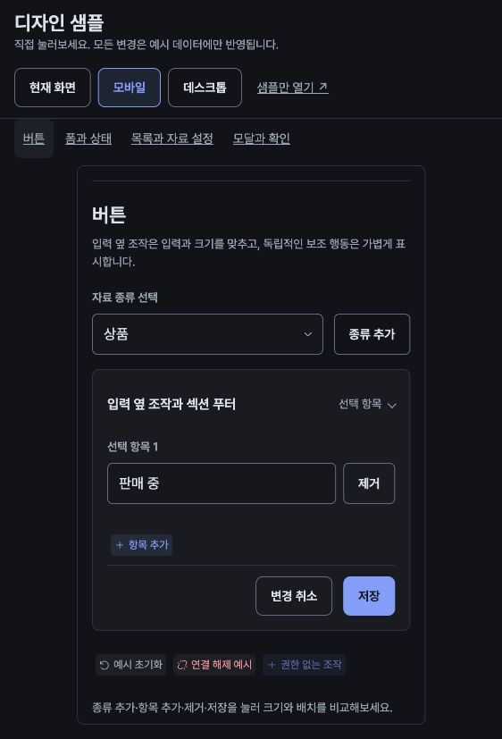

# 디자인 샘플

## 열기

`npm run dev`를 실행하고 Vite가 표시하는 주소의 `/design-samples/`를 연다. [HTML 진입점](../../design-samples/index.html)은 Vite가 React 코드를 처리하는 페이지이므로 서버 주소로 열어야 한다. Supabase 실행과 로그인은 필요하지 않다.

상단의 현재 화면·모바일·데스크톱 버튼으로 실제 미리보기 영역의 폭을 바꾼다. 같은 iframe의 폭만 바꾸므로 입력 초안·펼친 행·모달 단계가 유지된다. 좁은 창에서 데스크톱을 선택하면 미리보기 영역을 가로로 스크롤한다. `샘플만 열기`는 별도 창에서 직접 반응형을 확인하는 방법이다.

빌드에도 같은 페이지가 포함되며 앱의 base 경로 아래 `/design-samples/index.html`로 열 수 있다. `index.html`과 함께 빌드 자산·폰트를 제공해야 한다. 로컬 미리보기는 `npm run build` 후 `npm run preview`로 연다. 운영 공개는 별도 배포 요청의 범위다.

## 조작

샘플도 실제 앱과 같은 공식 shadcn 부품과 Tailwind 배치를 사용한다. 별도의 구 테마 CSS를 유지하지 않는다. 모의 결과는 업무 API를 호출하지 않으며 초안·확인·오류 상태의 조작을 제공한다.

- 기본 설정: 네 독립 저장 카드와 제목/폼 정렬을 확인한다. 샘플 주소에 `?screen=settings`를 붙이면 기본 설정만 볼 수 있다. 닉네임·시간대·배율 선택과 메뉴 순서·추가/제거를 바꾸고 섹션별 취소·저장을 확인한다. 프로필 아이콘 등 일부 입력을 생략한 구성 사례이며, 배율 선택은 샘플 자체의 실제 배율을 변경하지 않는다.
- 번호 설정: `?screen=issuers`에서 출처 목록 열기/접기·출처 편집, 번호 종류의 인라인 이름·사용 편집·취소·삭제와 출처 저장 → 첫 번호 종류 추가 → 나중에 추가를 조작한다. 실제 API 저장·충돌 복구는 앱에서 검증한다.
- 기록 설정: 여러 액션의 메모를 수정하고, 다른 액션으로 전환해도 미저장·오류와 함께 저장할 변경을 확인한다. 취소·저장은 해당 샘플 전체의 변경을 처리한다.
- 버튼: 종류 선택 옆 추가, 입력 옆 제거, 독립 보조 행동, 섹션 푸터를 비교한다.
- 폼: 실제 공통 키–값 쌍을 사용하며 가용 폭에 따라 여러 열/한 열로 바뀐다. 빈 상품명으로 입력 확인을 눌러 오류와 초점을 확인한다. 읽기 전용·비활성·0·긴 값도 비교한다. 반복 주기의 단일 선택·방향키와 시간대 선택도 조작한다.
- 필터: `?screen=filters`에서 필터만 볼 수 있다. 정렬·속성 조건·태그를 초안으로 바꾸고 `필터 적용` 전후의 결과를 비교한다. 초기화·검색어 자동 반영·필터 접기·번호 없는 조건 목록의 반응형 배치도 확인한다.
- 태그: 이 구역은 기본 기록 태그·필터처럼 부모 초안에 속하는 선택 사례다. 선택한 칩·개별/전체 해제와 중앙 모달의 이름 검색·체크·선택 완료를 조작한다. 빈 사전·조회 중/실패·이름 확인 필요·단일/10개 한도·저장 중을 비교한다.
- 목록과 자료 설정: 항목 열기/접기·순서 이동·헤더의 항목 추가·추가 설정·삭제를 조작한다. 일반 변경은 편집한 자리의 `변경 적용`으로 끝내며 이력은 자동으로 펼치지 않는다. 타입 변경·삭제나 명시적인 `변경 검토`는 당시 입력의 사본을 이력에 추가하며 이후 편집과 독립적이다. 이력 아래 변경 결과·적용·폐기를 확인한다. 기본 정보와 항상 펼친 기록 자동 완성은 각 섹션에서 저장한다.
- 모달과 확인: 상품명·읽기 전용 자료 번호·수량 0·판매 여부·긴 메모·태그를 보기와 편집의 같은 순서로 확인한다. 보기의 `태그 연결`은 별도 초안에서 `연결 적용`으로 확정하며 상품 편집 취소로 되돌리지 않는다. 편집의 태그는 정적 칩이고 연결 조작을 제공하지 않는다. 편집→저장 확인→확인 취소와 편집 취소→변경 폐기를 확인한다. 샘플 저장 결과를 실패 또는 결과 미확정으로 선택하면 초안/메모 유지·처리 중 잠금·재시도/결과 확인을 볼 수 있다. 확인의 전후값과 기록 메모는 키–값으로 표시하며, 확인의 기록 태그는 이 변경 기록을 만드는 초안이므로 계속 편집할 수 있다. 자료 삭제는 짧은 확인창이다.

키는 보조색, 값은 기본 글자색으로 표시하며 실제 공통 `Field pair`·`key-value-grid`·`key-value-static`을 사용한다. 넓은 미리보기와 좁은 미리보기를 오가며 행·초안·모달을 유지하고, 브라우저 글자 200% 확대에서도 확인한다.

변경은 해당 샘플의 메모리에서만 일어나고 새로고침하면 초기화된다. 태그 연결의 예시 적용도 실제 권한·버전·서버 충돌 처리를 구현하거나 검증했다는 뜻이 아니다. 샘플은 [디자인 가이드](guide.md)의 실행 가능한 사례이며 실제 API·자료 스키마 정책·데이터 변환을 구현하는 기능이 아니다.

## 유지

샘플 코드는 [src/design-samples](../../src/design-samples)에 있다. `Field`, `BodyAction`, `CollectionList`, `MaterialSettingsSection`, `SchemaDefinitionRead`, `ConfirmDialog`, `TagSelection`, `IssuerRow`와 공용 CSS·토큰을 사용한다. 샘플 전용 CSS는 미리보기 배치만 담당한다. 편집 모달의 예시 상태는 native dialog와 같은 공용 shell 클래스를 사용하고, 저장·폐기 확인은 실제 앱과 같은 `ConfirmationSurface`를 편집창 위에 연다.

시각 값은 [시각 규격](visual-spec.md), 행동은 [UI 패턴](ui-patterns.md)이 소유한다. 샘플에서 차이를 발견하면 기준과 실제 소비 화면을 함께 확인해 수정하며 샘플에만 다른 컨트롤 스타일을 추가하지 않는다.

브라우저 검사는 `npm run test:e2e -- --config playwright.design-samples.config.ts`로 실행한다. 서버 없이 예시 페이지의 반응형·초안 보존·동작과 공용 확인창을 확인하며, 실제 업무 API/MCP 검사의 대체물이 아니다.

## 화면 참고

[직접 조작하는 샘플](../../design-samples/index.html)의 모바일 버튼 사례다. 이미지의 조작은 HTML 페이지에서 확인한다.

